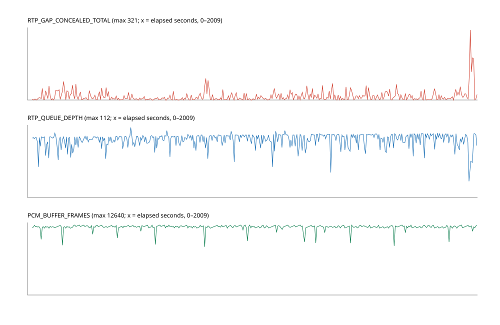

# PS3 AirPlay: independent forensic audit

Date: 2026-11-07, EDT. Investigation only; production sources, console execution, release artifacts and rollback tag were preserved.

## 1. Executive technical summary

The captured v0.2.5 run establishes sustained receiver execution and PCM submission for more than 33 minutes. It does **not** establish uninterrupted audible playback. The dominant directly observed defect is substituted silence: 6,886 missing-frame markers in completed telemetry intervals correspond to **54.9631 seconds** of 44.1 kHz audio. Zero reported PCM underflows does not contradict this: concealment fills the PCM ring with zeros.

The latest aligned counters reconcile: **26,994 missing observations = 20,108 accepted retransmission recoveries + 6,886 concealed frames**. This equality supports the interpretation for this run; it is not a universal conservation law. Reordering, duplicates, differing diagnostic boundaries, packets still queued and stream resets can break it.

**Strongest new finding:** all three payload caps are 1,400 bytes, smaller than a valid 1,416-byte uncompressed 352-sample stereo ALAC packet. Production rejects a deterministic FFmpeg fixture; an isolated 1,536-byte-cap experiment decodes it to exact reference PCM. This is a confirmed receiver defect and a strong explanation for content-dependent cuts; current logs omit the malformed/oversize counters needed to quantify its actual hardware contribution.

Other confirmed implementation weaknesses include silently abandoning resend requests for gaps larger than 16 packets, no retry of unanswered successful resend requests, concealment deadlines unrelated to actual playout time, ignored sender clock/sync information, and a resampler with substantial high-frequency interpolation error. The first three are transport/recovery defects; the interpolation error affects fidelity separately. **The current evidence cannot distinguish physical network loss from socket overflow, scheduling delays or sender behavior.** Do not diagnose Wi-Fi or “lossless quality” from these counters.

## 2. Exact revision and release identity

- Audit baseline: `2a30560`, branch isolated as `lily/sol61-forensic-audit`; production `main` has independent uncommitted documentation edits that this audit did not change.
- Packaged source: `9d9f60657f117daedc47c6b1bc3285a5982e5ae3`; production source/build scripts have no differences between that revision and audit baseline.
- AIRPLAY02 app v0.2.5, SFO `00.45`, PKG 3,232,048 bytes, SHA-256 `61e8310a6d4330bad1e4d64213365f9ba27de81a6fa14851a315f5b338894440`.
- Independently retrieved installed SFO: 1,040 bytes, SHA-256 `46f6db451213a62c04df9551c193d350ce637508865f69efc59563e114473d2d`, exact prior package-extracted SFO match.
- Independently retrieved installed EBOOT: 451,568 bytes, SHA-256 `aa1be7abb1c71148896346d1df9b24bcb1b32dd54d17ee8af6e5e5f003f4f482`; exact package-extracted SELF prefix, followed by 48 zero bytes.
- `safe-v0.2.4` dereferences to `f870d823f15398691a6a38e6393f8d1376161bee`. The annotated tag object is a different hash. It was not changed.
- Demo console: user-established Evilnat 4.93 CFW; prior Cobra 8.5 observation. Firmware was not re-probed in this audit.

The log embeds package version, **not a Git revision or package hash**. Attribution uses the installed binary comparison, version marker, retained build manifest and user's installation/launch report. This is a strong provenance chain, not a self-authenticating revision record inside the log.

Build chain reviewed: pinned PS3DK toolchain, PSL1GHT standalone runtime, Mbed TLS 3.6.7, ELF/NPDRM EBOOT/package validation and XX.YY SFO validation. No replacement package was built.

## 3. Acquisition and integrity

Read-only FTP acquisition began **2026-11-07 22:55:55 EDT** (`2026-11-08T02:55:55.036116Z`). Snapshot: **1,100,668 bytes**, SHA-256 **`f06503f5cfc2f51bdaed6edfbd793455da546f5fd4fb71f498286cb98c1cb861`**. FTP SIZE before RETR equalled bytes retrieved. The original bytes and acquisition metadata are retained under ignored local `work/forensic/`; raw logs are excluded from publication.

Earliest retained event: `01:44:14Z`; latest: `02:56:28Z` on November 8 UTC. The last device timestamp is approximately 33 seconds ahead of acquisition-host time. Clock offset is uncalibrated; use device-relative intervals, not assumed wall-clock simultaneity. No file wrap/cap occurs within the v0.2.5 session. A running-file FTP snapshot is not transactional; events after its EOF remain outside this audit.

All 17,362 lines parse. Four retained segments: an unidentified older wrapped tail (130 records, 299 seconds), v0.2.4 (56 records, 44 seconds, APP_STOP), another v0.2.4 (265 records, 37 seconds, capped), and v0.2.5 (16,911 records, 2,009 seconds, no APP_STOP). Lack of APP_STOP is expected for an application deliberately left running.

## 4. Complete retained-session timeline

Device UTC below; subtract five hours for November 7 local EST (or four hours for fixed EDT).

| Time | Evidence |
|---|---|
| 01:44:14–01:49:13 | Earlier unidentified log tail starts with LOG_WRAPPED and ends with cleanup/APP_STOP |
| 01:49:54–01:50:38 | v0.2.4 launch and clean stop |
| 01:50:58–01:51:35 | v0.2.4 launch, reaches per-launch cap; later behavior absent |
| 02:22:59 | v0.2.5 APP_START and package marker |
| 02:23:00 | Screen initialization 1920×1080, controller/network/mDNS/listeners/audio ready |
| 02:23:04 | DRAW_BEGIN 289 and MENU_OPEN 305 |
| 02:23:07 | DRAW_END 290, MENU_CLOSE 306, screen invalidation/resume request |
| 02:23:13 | One RTSP connection accepted |
| 02:23:15–16 | Apple challenge/response; ANNOUNCE, SETUP, RECORD; encrypted stereo 16-bit 44,100 Hz |
| 02:23:16 | Two volume changes; FLUSH discards one queued RTP frame and zero PCM frames |
| 02:23:17 | 128-packet prebuffer ready; first sampled decrypt/ALAC frame |
| 02:23:20–26 | Further volume changes |
| 02:23:29 | Only sampled valid timing reply, 6 ms RTT |
| 02:35:48–02:36:14 | Volume change cluster; no new ANNOUNCE, PAUSE, FLUSH or RECORD |
| 02:41:12 | Pad-data failure then PAD_DISCONNECTED; heartbeats and streaming continue |
| 02:55:56 | Worst five-second concealment interval: 321 frames |
| 02:56:26 | Last periodic audio metrics |
| 02:56:28 | Last sampled concealment/request events at snapshot EOF |

There are 201 heartbeats, with maximum spacing 10 seconds. The v0.2.5 run has one connection, one RECORD and one initial FLUSH; no later disconnect or stream reset. All 1,011 logged RTSP statuses are 200; 991 requests are OPTIONS. The analyzer retains all event distributions and significant transitions, including the 16 volume changes.

## 5. RTP accounting and counter contracts

| Metric | Measurement | Contract |
|---|---:|---|
| Original receive batches | 222,208 (434 × 512) | Parsed original datagrams; not unique playable packets |
| Missing batch sum | 26,980 | High-water sequence gaps; batch boundary differs from periodic report |
| Periodic missing sum | 26,994 | Interval delta despite TOTAL suffix |
| Accepted resend recoveries | 20,108 | Insertions into queue, not confirmed rendering |
| Concealed packets | 6,886 | Interval marker count, not sampled event values |
| Resend requests | 8,294 | Sum of `bytes` in RTP_RECOVERY_TOTAL |
| Gap waits | 1,267 | Interval deltas |
| Original duplicates / late | 10 / 26 | Batch deltas |
| Resend rejects: late / duplicate / invalid | 26 / 10 / 80 | Periodic deltas |
| Resend unmatched / queue-full rejects | 0 / 0 | Periodic deltas |
| Pending drops / tracking full | 0 / 0 | Periodic deltas |
| Large-gap skips | 0 | Periodic deltas |
| RTP queue sampled min / mean / max | 26 / 92.578 / 112 | Gauge; capacity 256 |

`raop_rtp.c:61–85` advances a highest-seen original sequence and increments missing on forward jumps. A late original does not decrement missing. Duplicates and reordering share the out-of-order counter; uniqueness is checked later. A new deterministic test delivers 10,12,11: missing becomes one despite perfect final output. Therefore the approximately 10.83% gap fraction calculated from batch originals and missing is **not a measured physical packet-loss rate**. Different final boundaries also prevent an exact fraction.

`raop_receiver.c:767–808` emits 512-original-packet batches; `main.c:674–758` emits five-second deltas. Do not add the two missing families. `RTP_RESEND_REQUEST`, `RTP_RESEND_RECOVERED` and `RTP_GAP_CONCEALED` contain sampled **sequence numbers**, not counts; count of those lines is also not total count. ALAC_FAIL_TOTAL is a cumulative decoder-epoch gauge. SCREEN_FLIPS is cumulative. The analyzer preserves unknown event types as distributions rather than dropping them.

## 6. Retransmission, recovery window and concealment

Pipeline: `raop_receiver_poll()` (`raop_receiver.c:924–1031`) selects sockets, handles RTSP first, reads at most one datagram per UDP channel, then schedules resends. Original packets pass RTP parsing, sequence accounting, sorted queue insertion, gap tracking and a pending resend FIFO. Control 0xd6 packets undergo sender/port/type validation, tracking lookup and queue recovery (`:610–709`). Playback pops and decrypts in `:1044–1082`; standalone decode and PCM push occur at `main.c:593–642`.

**Confirmed valid-payload rejection:** `raop_rtp.h:8`, `raop_crypto.h:10` and `raop_alac.h:10` each cap payloads at 1,400 bytes. Incompressible 352-sample stereo 16-bit content needs 1,408 sample bytes plus ALAC framing; the synthetic FFmpeg packet is 1,416 bytes. The RTP parser rejects it at `raop_rtp.c:50`, before sequence accounting, so the next accepted packet generates an apparent loss. A retransmission of the same frame is rejected by the same parser. Zero ALAC failures is expected because decoding never sees it. `malformed_packets` is not emitted in current diagnostics. In an isolated copied source tree, changing all three caps to 1,536 accepts the packet and produces exact 352-frame reference PCM under ASan/UBSan. No production headers were changed. This provides a concrete mechanism for song-dependent loss without physical packet loss. The hardware contribution remains unmeasured.

**Confirmed resend gap defect:** `queue_missing_audio()` (`raop_receiver.c:525–546`) returns immediately for count >16, without splitting the range and without a drop counter. Reproduced directly against the private function: count 17 queues nothing, count 16 queues one request. Thus zero pending drops does not prove every gap was requested. Hardware telemetry lacks gap-size histograms, so its contribution to the 6,886 markers cannot be quantified.

**Confirmed one-shot policy:** pending requests are removed after successful send (`:548–608`). Outstanding entries track replies and expire after one second; they never requeue unanswered requests. The global 50 ms minimum allows at most 20 requests/second; observed average is about 4.17/second, but instantaneous burst backlog is unknown. Splitting large ranges must preserve bounded backlog and avoid starving near-deadline packets.

**80 ms timer:** starts on the first attempted queue pop that sees the missing expected sequence (`raop_rtp.c:151–201`), not when the hole is first noticed on reception. PS3 uses `sysGetSystemTime()/1000`; host uses CLOCK_MONOTONIC (`raop_receiver.c:52–62`). Recovery before that pop deadline succeeds. After expiration, every contiguous hole is concealed without another 80 ms delay, until a real packet resets the wait state. Reproduction confirms a 20-frame gap produces 20 markers after one wait. Late recovery is rejected once its sequence is popped. If the queue is empty no gap timer starts. A backwards clock holds the wait until time catches up rather than timing out immediately.

The policy is bounded but **not coordinated with the remaining PCM lead or sender timestamps**. Mean PCM lead is ~278 ms and queue contents average ~739 ms of 352-frame packets (excluding holes); an unconditional early silence decision can discard recovery opportunities. However only 26 late retransmission rejects appear, so “resends arrive just too late” is not established as the dominant mechanism. Unrequested/never-returned holes are more plausible than a blanket timeout increase. Queue lead is not itself a measurement of negotiated end-to-end latency.

**Discard inventory:** malformed RTP/version/header/extensions/padding/payload >1400; wrong sender or session state; already-popped sequence; duplicate; full 256-entry queue; control reply validation/tracking; decrypt failure; decode failure; PCM push overflow; FLUSH; large-jump skip >128. RTP parser permits other payload types on the original channel (unlike resend validation). Sequence ordering uses signed 16-bit modular difference: correct within a half-range; jumps ≥32768 are ambiguous and need an explicit epoch/reset policy. Two sequence wraps pass. The 128-marker skip bounds large positive jumps but cannot repair arbitrary reset ambiguity.

Malformed original packets can also leave `last_missing_count` stale because parsing returns before `account_packet()` resets it (`raop_rtp.c:137–148`, receiver `:762–766`), causing repeat request scheduling. This is a source-confirmed edge case, without evidence it occurred here.

Concealment is **decoded zero PCM**, not a fabricated ALAC bitstream (`main.c:600–616`): fmtp[0] samples × channel count × two bytes. All sampled actual frames contain 352 samples. The source queues one negotiated frame per marker, but fmtp[0] is not independently logged. The duration calculation uses the strongly supported 352-frame session assumption: 6,886×352/44,100 = **54.9631 s**, or ~2.7633% of the 249,194 frames represented by queued PCM. The prior preliminary 5,117 count would mean **40.8432 s**, not milliseconds. Log EOF contains additional sampled markers after the latest interval, so 6,886 is not a final session count.

The worst 321-marker interval contains 2.5622 s of substituted source audio spread within approximately five seconds. It does **not** prove one continuous 2.56-second dropout. Burst lengths cannot be recovered from events sampled only every 16 markers. Zero insertion preserves sample duration for ordinary fixed-frame gaps but creates abrupt waveform edges that can click. Resampler state remains continuous while enough zero PCM is queued. Fades across boundaries could reduce clicks after transport defects are fixed; they cannot restore missing content.

## 7. Audio clock and resampler

RTP timestamps are parsed (`raop_rtp.c:54`) but not used for scheduling or sample-count reconciliation. Control packets other than resend are counted and ignored (`raop_receiver.c:810–813`), including sender sync 0xd4. Timing probes log RTT, not a sender/local clock mapping. 38 sampled timing-bad events cannot reveal exact rejection reasons or total bad replies. One sampled valid reply does not establish synchronization.

The PCM converter keeps integer phase across normal calls (`pcm_ring.c:101–141`). Reproduction over **600 simulated seconds**: 28,800,000 output samples per channel consume 26,460,002 input frames, including two lookahead frames; phase returns to zero, underflows zero. Actual hardware accounting independently agrees: 87,703,730 consumed minus 95,459,840×147/160 = **2 frames**. This rules out a large nominal sample-ratio error in the captured intervals, not independent hardware clock drift.

FLUSH explicitly clears phase and PCM; underflow also clears phase/current lookahead. Decoder errors drop packets without equivalent silence, potentially compressing time, but none is reported here. Large gap skip intentionally compresses timeline; none is logged here. No continuous drift correction or output timestamp verification exists.

Linear interpolation has measured fidelity loss against deterministic sine reference: 54.64 dB SNR at 1 kHz; 26.78 dB at 5 kHz; 15.03 dB at 10 kHz; 8.47 dB at 15 kHz; 4.17 dB at 20 kHz. Amplitude at 20 kHz is ~0.482 of reference. These test errors include deterministic interpolation/quantization effects; they are not microphone measurements or proof of the dropout cause. Improving conversion is justified for high fidelity, after recovery is controlled.

## 8. PCM buffering, GameOS output and shared scheduling

Periodic queued frames **87,716,288**, consumed **87,703,730**, difference **12,558**, exactly the last PCM occupancy. PCM min/mean/max: **8,698 / 12,250.85 / 12,640** of 16,384 input frames (~197–287 ms at 44.1 kHz). No PCM_UNDERFLOW, PCM_DROP or RTP_QUEUE_DROP_BATCH is recorded. Concealment contributes to the queued count.

GameOS submission: **95,459,840 frames**, equivalent to 1,988.7467 nominal seconds at 48 kHz. These are copied frames, not an HDMI loopback measurement. `main.c:293–308` writes `(*read_index + 1) % numBlocks`. The loop receives one audio notification at a time (`:644–649`); delayed queued notifications can lead to repeated writes at the current index without proving missed physical blocks were recovered. Hardware notification lag and per-block identity are not logged.

One main loop handles controls, graphics, network, mDNS, up to four decodes, one audio event and synchronous log flushing (`main.c:494–759`). `receiver_log.c:64–100` flushes every event. Approximately 16,911 events across 2,009 seconds is only ~8.42 events/s on average; burst disk latency, decode latency and syscall duration remain unmeasured. Per-packet AES context setup, ALAC's 32 KiB guard clearing (`raop_alac.c:8,104–109`) and sorted packet copies add work, without measured evidence they exceed deadlines. Do not optimize these based on guesswork.

## 9. iPhone application switching

There is one continuous format and recording epoch after initial FLUSH. All 16 SET_PARAMETER events correspond to volume update instrumentation; no second format negotiation or app identifier is logged. The log cannot identify Spotify versus a short video's sound. No app transition should be inferred from silence, packet size or a volume cluster.

Source supports volume gain/ramp (`raop_session.c:149–208`, `pcm_gain.c:24–42`), PAUSE/RECORD and RTP/PCM FLUSH. FLUSH does not parse an RTP-Info cutoff; it drains bounded original datagrams but not all control/timing datagrams. Old in-flight data can arrive into a new epoch. PAUSE destroys decoder/PCM and clears RTP; resumption requires the full 128-packet prebuffer. ANNOUNCE is not accepted during RECORDING, so in-session format renegotiation is unsupported. Unknown parameters/content types can be acknowledged without application (`raop_session.c:154–157,180–188,675–685`). Test app switching with explicit FLUSH cutoffs and epoch telemetry before claiming compatibility.

## 10. Graphics, system menu and controller

Observed DRAW_BEGIN/END and MENU_OPEN/CLOSE are paired, with 161 cumulative screen flips after the initial menu interaction. Flips then stay constant while audio artifacts continue for ~30 more minutes: continuous application flips cannot explain those later artifacts. This does not prove VSH/compositor activity is absent.

Source tracks MENU events but does not use DRAW_BEGIN/END to control rendering (`main.c:94–113`). `diagnostic_screen_present()` (`diagnostic_screen.c:202–253`) flips while the menu flag is true, then repairs dirty buffers and returns to a static image. Callback arrival order, compositor ownership and final draw completion are not coordinated. A dim overlay/frozen indicator may persist when scanout stops before VSH completes its transition. That is a **hypothesis**, not a confirmed restoration fix; callbacks do not prove visible pixels. Initialization and close waits now have 500 ms bounds (`:52–73,256–272`). No arbitrary RSX/LV2 patch is justified.

Controller initializes and initially produces reports; at 02:41:12 it reports one error and disconnects. Heartbeats persist; this alone does not indicate an app hang. Battery/auto-off/disconnection versus API failure is unresolved. No START test was requested or performed during the soak. Preserve the user-confirmed earlier START and PS-menu functionality; validate any future presentation change in two manual launches with clean START exit.

## 11. Confirmed defects and validation boundaries

1. Valid 1,416-byte ALAC payload rejected by all three 1,400-byte caps (production versus isolated-copy reproduction).
2. >16 sequence gaps silently omitted from recovery queue (direct production-function reproduction).
3. Successful unanswered resend requests receive no retry (source).
4. Missing telemetry counts gaps, not final physical loss (reproduced loss-free reorder).
5. No timestamp-based sender synchronization or explicit FLUSH cutoff (source).
6. Significant high-frequency linear interpolation error (production converter measurements).
7. Sampled sequence logging and UTC-second resolution cannot establish recovery latency or exact burst lengths (source).
8. Malformed originals can reuse stale gap metadata (source edge case).

Only the substituted silence is directly established on current hardware. The contributions of the recovery defects require added instrumentation and controlled comparison. Zero decoder failures does not prove bit-perfect ALAC output on every hardware frame; host fixture decoding does match reference PCM.

## 12. Ranked root-cause hypotheses

| Rank | Candidate and confidence | Supporting evidence / contradiction | Audible symptom and corrective validation | Regression risk |
|---|---|---|---|---|
| 1 | Payload cap rejects valid high-entropy ALAC; confirmed defect, strong hardware hypothesis | 1,416-byte FFmpeg fixture fails production and decodes exactly with copied-source caps raised; content-dependent user symptoms; actual oversize hardware count absent | Content-dependent silence/clicks; align RTP, AES and codec bounds with supported negotiated frames and datagram budget; test compressed/uncompressed encrypted frames and exact PCM | Bounded memory increase, malformed-input exposure |
| 2 | Unrequested/one-shot recovery holes; confirmed defects, high confidence they can cause interruptions, unquantified hardware share | 6,886 silence markers; >16 omission reproduced; only 26 late resend rejects; zero pending overflow does not measure omitted ranges | Cuts/clicks; split bounded ranges, retry outstanding holes until deadline; compare exact gap/request/reply/expiry IDs | Duplicate requests, burst traffic, FIFO backlog |
| 3 | Physical loss or receiver socket loss; medium, unresolved origin | Persistent high gap rate with recovery; no kernel/socket drop data; no PCM starvation | Cuts; count socket overflow, arrival lateness and receive service gaps; controlled wired-path experiment later | More receive work may starve controls/audio |
| 4 | Fixed recovery deadline decides silence before true playout deadline; confirmed design gap, medium hardware attribution | 80 ms head wait versus ~278 ms PCM lead; few late rejects argue against a universal late-reply explanation | Avoidable silence; virtual-time deadline comparison with same arrival trace | Latency growth or queue saturation |
| 5 | Shared-loop stall / stale GameOS notification; medium-low | Synchronous flush, decode, graphics share loop; PCM remains healthy; no notification lag evidence | Repeated/missed output blocks despite healthy ring; measure deadlines/read indices before threading | Input or output lifecycle regressions |
| 6 | Missing sender-clock mapping/drift control; confirmed omission, low evidence as immediate dropout cause | Ignored sync and nearly all sampled timing replies rejected; exact nominal ratio and stable sampled occupancy contradict gross drift | Long-term drift/skips; ±100–500 ppm simulation and clock mapping | Pitch/latency changes |
| 7 | SRC spectral error; confirmed fidelity defect, low dropout attribution | Poor high-frequency reference fidelity; exact sample ratio, no underflow | Dull/rough sound; compare bounded polyphase candidate to reference | CPU cost, phase/delay changes |
| 8 | Compositor resume state; medium for display, low for ongoing audio | Menu callback and dim/frozen user observation; flips stop long before later silence markers | Frozen/dim screen; bounded redraw handshake with paired DRAW events | Previously broken PS/START support |

## 13. Reproducible tests and results

- `bash scripts/run-forensic-tests.sh`: host ASan/UBSan production RTP/PCM reproductions PASS; two analyzer fixture tests PASS. Tests cover 131,072 in-order packets/two wraps, reorder without loss, original/resend arrival at 79 ms, timeout burst concealment, post-concealment late reject, FLUSH epoch reset, 600 seconds resampler conservation, and 10,000 packets with deterministic 0–600 ms arrival jitter and 1,024 ms playout lead. The jitter case renders every packet with zero concealment/drops while the high-water missing counter reaches 8,815: direct evidence that missing observations can be artificial under reordering.
- Linux with existing Mbed TLS 3.x headers: `MBEDTLS_INCLUDE=<existing-include-dir> bash scripts/run-forensic-tests.sh` additionally reproduces the private >16 gap policy. Direct Linux run passed. Mac runner explicitly skips this Linux linker-specific case.
- Synthetic 1,416-byte ALAC fixture: production RTP parse and ALAC decode both reject; isolated caps raised to 1,536 both pass and reference PCM matches byte-for-byte (352 samples), ASan/UBSan clean. `run-forensic-tests.sh` reproduces both outcomes without editing production.
- Existing host-test portion of `scripts/build-lima-crypto.sh` (HOST_TEST through tone test) rerun in a separate guest directory using existing dependencies: crypto/base64/AES/RSA, session crypto/state/SDP, discovery, persistent RTSP/UDP, bounded slow-reader disconnect, encrypted decrypt→ALAC→PCM loopback, 4,352 malformed ALAC cases, log append/full cap, PCM, quality, gain and tone tests all PASS with existing sanitizer settings. No PPU/package rebuild performed.
- Existing `tests/protocol/raop_rtp_test.c` additionally run with ASan/UBSan (results recorded with audit completion). It covers duplicate/queue capacity/large gap/wrap behavior; these tests cannot measure the PS3 network stack.
- Analysis: `python3 scripts/analyze-hardware-log.py <private-snapshot> --output <private-summary.json> --plot <timeline.svg>`; zero unparsed lines. JSON includes every event distribution, application/connection/playback boundaries, cap/wrap status and transition timeline.
- No new RPCS3 run: existing emulator fixture infrastructure uses alternate RTSP port 5001 and historical clean pipeline/exit evidence; it neither reproduces current physical loss nor authenticates this hardware snapshot. This audit's new results are host tests and physical read-only telemetry. A full sender/crypto/physical-output virtual-time simulation (beyond the new queue-level jitter test) and real GameOS notification-lag reproduction remain unperformed, explicitly below the acceptance boundary.

## 14. Recommended fixes and resource estimates

Estimates are engineering budgets, not measured PS3 costs.

| Change | Complexity / benefit | CPU / memory / latency | Required tests / risk |
|---|---|---|---|
| Align payload limits with valid negotiated ALAC sizes | Small; eliminates demonstrated valid-frame rejection | Low; 1,536 vs 1,400 adds ~34 KiB across 256 payload slots, plus bounded scratch; no intended latency | Compressed/uncompressed AES/ALAC exact-reference and maximum-boundary fuzz; reject oversized offers safely |
| Monotonic interval telemetry and explicit counter contracts | Small; locates actual failed stage | Low; fixed histogram/counters <16 KiB budget; no intentional latency | Counter reset/wrap tests; capped output; logging can still stall unless batched |
| Split >16 gaps and retain per-hole retry eligibility | Small-medium; restores currently omitted recovery | Low average, bounded bursts; existing tracked ranges plus bounded metadata; no intentional playback increase | 16/17/32/128 gaps, loss/reorder/resend loss, rollover, flood bounds; network load |
| Budgeted multi-datagram drain and batch diagnostics | Medium; reduces receiver-induced drop risk if confirmed | More bounded per-iteration CPU; socket buffer budget measured before change; no intended latency | Burst receive plus controller/audio starvation tests; scheduling regression |
| Map packet deadline to queued PCM and sender clock | Medium-large; avoids premature concealment and drift | Low arithmetic cost; bounded clock-fit history, small KiB budget; retain explicit maximum latency | Replay same arrival traces at 79/80/81 ms and ±ppm, suspend/restart; clock instability |
| Short concealment boundary fades | Small; reduces clicks, does not recover content | Negligible per-loss ramp; sample-history buffer <1 KiB; ≤few-ms effect | Step/sine error, burst limits, channel consistency; masks symptoms if evaluated alone |
| Better fixed-ratio resampling | Medium; improved spectral fidelity | Measured FIR CPU required; proposed 16–32 taps ×2×48k = ~1.54–3.07M multiply-accumulates/s; coefficients/history bounded | Reference sweep/impulses/phase/long-run ratios; added group delay/CPU |
| Menu DRAW/scanout restoration experiment | Medium; possible display recovery | Redraw cost must be measured; existing buffers; bounded transition refresh only | Manual PS/menu/START twice plus concurrent stream; input/display regressions |

## 15. Implementation order

1. Correct and regression-test the demonstrated valid-payload rejection in an isolated development pass. Choose one shared validated bound (1,536 covers the tested 352-sample case, not arbitrary supported 4,096-sample uncompressed frames); constrain negotiation or support larger bounded frames consistently. Include encryption/tail and oversized-invalid cases.
2. Add compact monotonic gap-size, request lifecycle, arrival and GameOS deadline counters; avoid per-packet disk writes. Preserve the current package as the comparison baseline.
3. Reproduce and correct >16 omission plus unanswered-request retry policy on an isolated branch; keep bounds and compare identical deterministic traces. Do not simply enlarge 80 ms.
4. Measure receive/socket/output service gaps; then decide whether a bounded receive drain suffices or a separate output worker is warranted.
5. Implement sender sync/deadline mapping and FLUSH sequence cutoffs, with bounded drift correction only after clock telemetry is credible.
6. Add concealment smoothing and improved resampling, evaluated separately from transport recovery.
7. Isolate menu restoration with existing buffers and event ordering. Require user-visible display, PS and START tests alongside streaming.
8. Only with separate hardware deployment authorization for that work: 30 s, 5 min, 30 min comparison, seeking/app switching, volume/mute, reconnect and clean exit. No deployment was performed by this investigation.

## 16. Remaining unknowns

No sender-side capture, exact physical loss, socket overflow count, actual request/response age distribution, maximum burst lengths, per-packet ALAC frame length, true output delay, HDMI loopback, temperature/memory series, or independent hardware-clock estimate. No evidence attributes short-video content, controller disconnect cause or the dim overlay's precise compositor state. 33-minute process/stream telemetry is established; uninterrupted audible music and final clean exit are not verified for this run. The earlier user reported audible songs, with stutters. This audit does not override that observation.

## 17. Additional telemetry required

Use relative monotonic microseconds plus UTC launch anchor and embedded source/package identity. Publish numeric aggregate diagnostics only. Emit malformed/oversized datagram and payload histograms before parse rejection, with numeric size/reason only; distinguish original from resend. Record fixed histograms for original/retransmit arrival spacing, gap size, request enqueue→send→reply→deadline, attempts, omitted range reason, pending age/depth, late original/resend and conceal burst lengths. Record sequence-relative/timestamp-relative epochs, expected/actual PCM counts, distinct decoder failure and transport-drop categories; no peers, raw SDP, keys or audio samples.

For output, record notification age, current read index/block generation, submitted block index, missed/repeated indices and per-stage maximum/histogram duration (network, decode, logger flush, graphics, callback). For timing, classify invalid replies by length/type/source-port/sequence/originate match, process sender sync anchors and report fitted drift/error. Log DRAW_BEGIN/END, MENU_OPEN/CLOSE, pending flip completion and final restoration result without claiming visual success.

### Upstream behavior references

Reviewed upstream source directly on this audit date; moving `master` URLs are behavior references, not pinned PS3 dependencies. [Shairport Sync player.c](https://github.com/mikebrady/shairport-sync/blob/master/player.c), lines 1650–1739, tracks repeated missing-frame requests against remaining latency. [Shairport Sync rtp.c](https://github.com/mikebrady/shairport-sync/blob/master/rtp.c), lines 296–341 and 635–831, processes sync anchors and estimates sender-clock relationship. These support the direction of recovery/clock work, not copying its desktop buffer sizes or threading. [PSL1GHT videoTest](https://github.com/ps3dev/PSL1GHT/blob/master/samples/graphics/videoTest/source/main.c), lines 52–76, demonstrates normal flip/buffer ordering; it does not establish a PS-menu restoration protocol.
